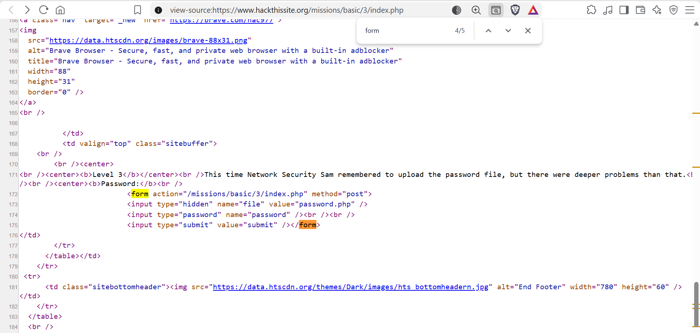
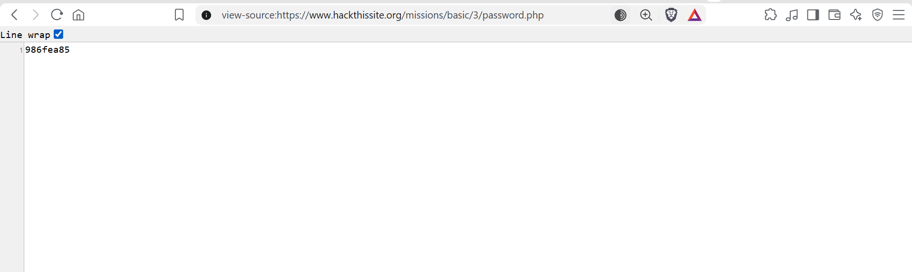
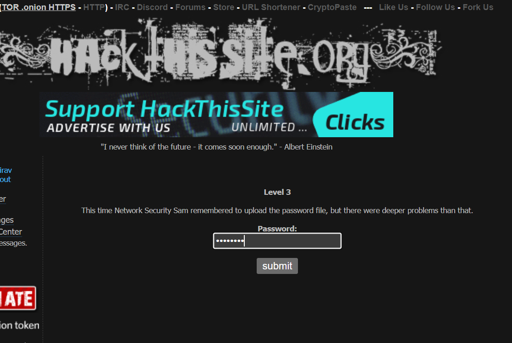

## Steps to Solve the Problem:

Q. Read the question carefully. It indicates that the password is stored somewhere in the website's source code.

1. **Inspect the source code:** Open the page source (`Ctrl + U`) and search for keywords such as `password`, `pass`, or `input`.

2. **Locate the PHP page:** Look for a PHP-based page reference near the question number in the source code.
3. **Retrieve the password:** Identify the password string stored in the source code.

   
   
4. **Submit the password:** Use the extracted string to complete the challenge.

   

**Eureka! 💡**

